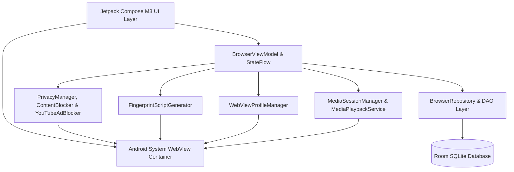

<div align="center">

# 🌐 Feather Browser for Android

<p align="center">
  <strong>An ultra-lightweight Android browser with isolated browsing profiles, privacy controls, and customizable web identities.</strong>
</p>

[](https://github.com/aanneion/feather_browser/releases)
[](https://github.com/aanneion/feather_browser/actions)
[](https://github.com/aanneion/feather_browser/releases)
[-3DDC84?style=for-the-badge&logo=android&logoColor=white)](https://www.android.com/)
[](https://kotlinlang.org/)
[](https://developer.android.com/jetpack/compose)
[](LICENSE)

<br />

[🌟 Core Differentiators](#-core-differentiators) • [🛡️ Browsing Profiles](#-browsing-profiles--web-identity-preferences) • [✨ Feature Highlights](#-feature-highlights) • [🛠️ Architecture](#-architecture--tech-stack) • [🚀 Building from Source](#-building-from-source) • [🔑 Release Signing & Updates](#-release-signing--seamless-in-place-updates)

---

</div>

## 📖 Overview

**Feather Browser** is an open-source, minimalist Android browser designed for low overhead and practical privacy controls. It offers isolated browsing profiles, a built-in ad and tracker blocker, and background web-media playback with lock-screen controls.

Built purely in **Kotlin** and **Jetpack Compose (Material Design 3)**, Feather delivers dynamic Material You theming, instant cold starts, and buttery-smooth 120Hz scrolling.

---

## 🌟 Core Differentiators

| Unique Capability | Why It Sets Feather Apart |
| :--- | :--- |
| 🪶 **Ultra-Lightweight (~1.6 MB)** | 90%+ smaller than standard browsers (Chrome ~150MB, Firefox ~90MB). Stripped of unnecessary bloat, third-party analytics SDKs, and background daemon services. |
| 👥 **Organized, Isolated Browsing Profiles** | Separate tabs, bookmarks, history, downloads, shortcuts, cookies, and site storage for personal, work, and testing workflows. User-created profiles use their own WebKit `Profile` on supported WebView versions. |
| 🎭 **Per-Profile Web Identities** | Each profile can have its own user-agent, client-hint/fingerprint preset, ad-blocking preference, third-party-cookie policy, and background-play setting. These are compatibility/privacy controls, not anonymity guarantees. |
| 🎵 **YouTube & Background Media Play** | Seamless background audio playback when screen is locked or browsing other tabs. Full Android `MediaSession` lock screen and notification bar controls with per-video thumbnails and a live, seekable progress bar. |
| 🛡️ **Enhanced Ad & YouTube Blocker** | Document-start response filtering for modern YouTube player APIs (`get_watch`, `player`, `next`, `browse`, reels), ad-only media-segment blocking, DOM cleanup, and an unskippable-ad fallback that never leaves the content muted or fast-forwarded. |
| ⚡ **Instant Cold Boot & Low RAM Usage** | Near-zero startup latency with optimized R8 tree-shaking and memory-efficient Compose layout trees. |

---

## 🛡️ Browsing Profiles & Web Identity Preferences

Feather keeps tabs, bookmarks, history, downloads, shortcuts, cookies, and site storage organized by profile. On **AndroidX WebKit 1.12+ / WebView 122+**, each user-created profile gets its own WebKit `Profile` (cookies, `localStorage`, IndexedDB, HTTP cache, and service workers) through `ProfileStore` and `WebViewCompat.setProfile`. The built-in `default_personal` profile stays on the default WebView profile so existing installs keep their logins; private sessions use a dedicated `private_session` profile that is cleared when private mode ends. On older WebView versions Feather falls back to the shared default profile and the UI says so.

This is **storage isolation**, not a hardened OS security sandbox. Use separate Android users or a dedicated security product if you need OS-level isolation.

```
┌────────────────────────────────────────────────────────────────────────┐
│                        Feather Browser Engine                          │
└───────┬────────────────────────┬────────────────────────┬──────────────┘
        │                        │                        │
  ┌─────▼──────────────┐   ┌─────▼──────────────┐   ┌─────▼──────────────┐
  │  Profile: Personal │   │    Profile: Work   │   │  Profile: Stealth  │
  ├────────────────────┤   ├────────────────────┤   ├────────────────────┤
  │ • Native Android   │   │ • Windows 11 Chrome│   │ • Pixel 9 Pro      │
  │ • Personal Cookies │   │ • Work SSO Cookies │   │ • Canvas & WebGL   │
  │ • Home Bookmarks   │   │ • Corp Bookmarks   │   │   Noise Spoofing   │
  │ • Independent Tabs │   │ • Independent Tabs │   │ • Independent Tabs │
  └────────────────────┘   └────────────────────┘   └────────────────────┘
```

### 🎭 Built-in Compatibility Presets
1. **Native Mobile (Android)** — default WebView UA, `Linux armv8l`, 8-core / 8 GB profile.
2. **Windows 11 Workstation (Chrome)** — desktop Chrome UA, `Win32`, 16-core / 16 GB profile.
3. **macOS Sequoia (Chrome)** — macOS desktop Chrome UA, `MacIntel`, 12-core / 16 GB profile.
4. **Samsung Galaxy S24 Ultra** — Android 14 flagship mobile Chrome UA.
5. **Linux Workstation (Chrome)** — Linux x86_64 desktop Chrome UA.
6. **Google Pixel 9 Pro** — Android 15 Pixel mobile Chrome UA.

Presets are compatibility/privacy presets, not anonymity guarantees. A profile can also use a custom User-Agent; the identity is injected at document start and open WebViews are recreated when it changes.

### ⚙️ Per-Profile Privacy Settings
- **Ad blocking** — on/off per profile.
- **Third-party cookies** — block or allow per profile.
- **Background media playback** — on/off per profile.
- **Clear cookies & site data** — clears one profile without touching the others.
- **Delete profile** — removes the profile's WebKit storage and its local tabs, bookmarks, history, downloads, and shortcuts.
- **Private mode** — uses a dedicated private-session WebKit profile; cookies and site data are cleared when leaving private mode or switching profiles.

Cookie and site-storage isolation requires WebView 122+. On older WebView versions, profiles still separate tabs, history, bookmarks, and downloads, but share the WebView cookie jar.

### 💡 Real-World Use Cases:
- **Multiple Account Management**: Keep separate logins for the same site (GitHub, Google, Reddit, social media) in different profiles without logging out or using incognito windows.
- **Tracker Defeat**: Isolate cookies and storage between personal, work, and testing identities, and give each profile its own fingerprint preset.
- **Web Developer & QA Testing**: Verify responsive layouts, User-Agent-specific behavior, and client-hint variations directly on device.
- **Private Browsing**: Use private mode for one-off sessions without leaving cookies or site data behind.

---

## ✨ Feature Highlights

- 🎵 **YouTube & Background Media Playback**: Continue playing audio from YouTube and web media seamlessly in the background when switching tabs, minimizing the browser, or locking the device, with an audible-tab indicator in the tab manager and correct hand-off between tabs.
- 📱 **Immersive Full-Screen Web Browsing**: Dynamic auto-hiding top URL bar and bottom navigation dock that glide away when scrolling down and smoothly return when scrolling up.
- 📱 **Lock Screen & Notification Player Controls**: Full Android `MediaSession` integration providing lock screen playback controls, live video title, channel and thumbnail artwork that follow every video change, a seek bar synced with the YouTube progress bar, 10-second skip buttons, playback speed control, seeking straight from the notification, lock screen, or headset, and audio focus handling so calls, alarms and navigation prompts pause or duck playback like in Chromium based browsers.
- 🛡️ **Enhanced YouTube & Web Ad Blocker**: Document-start filtering for modern YouTube player responses (`get_watch`, `player`, `next`, `browse`, reels, watch, playlist), ad-only media-segment blocking, CSS/DOM cleanup, and a fallback that skips unskippable ads without leaving the real video muted or fast-forwarded.
- 🎨 **Material You Dynamic Theming**: Adapts seamlessly to your device's Android 12+ wallpaper colors, with Light, Dark, and true Pitch-Black (`#000000`) AMOLED modes.
- 👥 **Isolated Profiles**: Separate tabs, history, bookmarks, downloads, shortcuts, cookies, and site storage. User-created profiles use isolated WebKit `Profile`s on WebView 122+; `default_personal` keeps the default profile for update continuity.
- ⚙️ **Per-Profile Privacy Controls**: Choose ad blocking, third-party cookie blocking, background playback, fingerprint preset, and custom User-Agent independently for each profile.
- 🕵️ **Private Tabs**: Private mode uses a dedicated WebKit profile on supported versions; cookies and site data are cleared when leaving private mode or switching profiles. Older WebView versions fall back to the shared store.
- 🔍 **Multi-Engine Search Selector**: Switch instantly between Google, DuckDuckGo, Brave Search, and Bing directly from search settings.
- 📑 **Visual Tabs Manager**: Intuitive tab switcher with real-time website favicons, tab counts, and swift swipe-to-dismiss gestures.
- 📱 **Desktop Site Mode**: Instant one-tap switcher between mobile and desktop site layouts.
- 🔎 **In-Page Find & Highlight**: Live text search within web pages featuring match indicators and jump navigation.
- 🌤️ **Live Local Weather Card**: Zero-permission real-time weather forecasts powered by open-meteo using privacy-respecting IP-based geolocation, complete with temperature toggle (°C/°F) and cache efficiency.
- 💾 **Local-Only Persistence**: Fast Room database with SQLite for bookmarks and history. Zero cloud sync or telemetry.
- ⬇️ **Native Download Manager**: Integrated download handler with file opening, progress tracking, and clean directory management.

---

## 🛠️ Architecture & Tech Stack



- **Language:** 100% [Kotlin](https://kotlinlang.org/) with Coroutines & StateFlow
- **UI Framework:** [Jetpack Compose](https://developer.android.com/jetpack/compose) with Material Design 3 (M3)
- **Web Rendering:** Android System WebView with AndroidX WebKit (`ProfileStore`, `WebViewCompat.setProfile`, `DOCUMENT_START_SCRIPT`)
- **Data Persistence:** [Room Database](https://developer.android.com/training/data-storage/room) with SQLite (schema v5, per-profile privacy fields)
- **Architecture Pattern:** MVVM (Model-View-ViewModel) + Unidirectional Data Flow (UDF)
- **Optimization:** R8 full-mode shrinking, ProGuard optimization, resource stripping

---

## 🚀 Building from Source

### Prerequisites
- **JDK:** OpenJDK 17 or OpenJDK 21 (JDK 21 recommended; CI uses JDK 21)
- **Android Studio:** latest stable with AGP 9.1 support
- **Android SDK:** Platform 36 (Android 16) + Build Tools 36.x
- **Gradle:** the wrapper is included (`gradlew` / `gradlew.bat`)

### Clone & Build
```bash
# 1. Clone the repository
git clone https://github.com/aanneion/feather_browser.git
cd feather_browser

# 2. Run unit tests
./gradlew :app:testDebugUnitTest

# 3. Assemble release APK (release signing env vars required)
./gradlew :app:assembleRelease
# Output: app/build/outputs/apk/release/app-release.apk
```

On Windows PowerShell:
```powershell
.\gradlew.bat :app:testDebugUnitTest
.\gradlew.bat :app:assembleRelease
```

For Google Play, build an Android App Bundle instead:
```bash
./gradlew :app:bundleRelease
# Output: app/build/outputs/bundle/release/app-release.aab
```

---

## 🔑 Release Signing & Seamless In-Place Updates

### Why Android Shows "App Not Installed" or Google Play Protect Warnings
When downloading consecutive APK builds without a persistent release keystore, each build is signed with an ephemeral debug or temporary key generated on-the-fly. Android's Package Manager enforces cryptographic signature identity:
1. **"App not installed as package appears to be invalid / conflicts with an existing package"**: Triggered when trying to install an APK whose cryptographic certificate signature differs from the currently installed version. Android strictly blocks overwriting app data to prevent unauthorized app hijacking.
2. **Google Play Protect / "Unrecognized App" Warning**: Displayed for any sideloaded APK whose signing certificate has not yet accrued reputation in Google Play Protect's cloud telemetry.

### The Permanent Solution (Used by NewPipe, Tachiyomi, VLC)
Open-source Android applications solve the **signature-conflict** problem permanently by creating **one persistent Release Keystore**, storing it securely as a GitHub Repository Secret, and letting GitHub Actions automatically sign every release with this exact same certificate. This guarantees in-place updates; it does not remove every generic Play Protect warning for sideloaded APKs (see Step 5).

#### Step 1: Generate Your Permanent Keystore Locally
On Windows, the included helper is the easiest option. It hides the password while typing, creates `$HOME\feather-release.keystore`, verifies it, and writes `keystore_base64.txt` in the repository root:

```powershell
powershell -ExecutionPolicy Bypass -File .\scripts\generate-release-keystore.ps1
```

It prints the certificate SHA-256 and the exact secret names/values you need in Step 3. Use a **new** password that has never been pasted into a chat or terminal history.

<details>
<summary>Manual keytool commands (Linux/macOS/Git Bash/WSL, or if you prefer not to use the helper)</summary>

Open your terminal (Linux, macOS, or Windows Git Bash / WSL) and run:
```bash
keytool -genkeypair -v \
  -keystore release.keystore \
  -alias feather_release_key \
  -keyalg RSA \
  -keysize 2048 \
  -validity 10000 \
  -storepass <strong-store-password> \
  -keypass <strong-key-password> \
  -dname "CN=Feather Browser, OU=Mobile, O=Feather Privacy, L=San Francisco, ST=California, C=US"
```

On Windows PowerShell, use the backtick as the line-continuation character:
```powershell
keytool -genkeypair -v `
  -keystore "$HOME\feather-release.keystore" `
  -alias feather_release_key `
  -keyalg RSA -keysize 2048 -validity 10000 `
  -storepass "<strong-store-password>" `
  -keypass "<strong-key-password>" `
  -dname "CN=Feather Browser, OU=Mobile, O=Feather Privacy, L=San Francisco, ST=California, C=US"
```

*(Use unique, strong passwords and store them only in a password manager or CI secrets. Back up `release.keystore` safely—if it is lost, existing users cannot update without uninstalling.)*

</details>

#### Step 2: Convert Keystore to Base64 String
If you used the helper script, `keystore_base64.txt` is already created—skip to Step 3. Otherwise, encode the binary keystore file into a clean string so it can be safely stored in GitHub:
```bash
# On Linux / macOS:
base64 -w 0 release.keystore > keystore_base64.txt
# (On macOS if -w 0 is unsupported: base64 -i release.keystore | tr -d '\n' > keystore_base64.txt)

# On Windows PowerShell (matching the $HOME path from Step 1):
[Convert]::ToBase64String([IO.File]::ReadAllBytes("$HOME\feather-release.keystore")) |
  Set-Content -NoNewline -Encoding ASCII keystore_base64.txt
```

#### Step 3: Add to GitHub Repository Secrets
1. Go to your GitHub repository: `https://github.com/YOUR_USERNAME/YOUR_REPO`
2. Navigate to **Settings** → **Secrets and variables** → **Actions**.
3. Click **New repository secret**:
   - **Name:** `RELEASE_KEYSTORE_BASE64`
   - **Secret:** Paste the entire contents of `keystore_base64.txt`.
4. Add these repository secrets as well:
   - `STORE_PASSWORD`
   - `KEY_ALIAS` (for example `feather_release_key`)
   - `KEY_PASSWORD`

> All four secrets are required. The workflow intentionally **fails** if any of them is missing, instead of generating a new key. This is what prevents a differently signed APK from ever being published.

#### Step 4: Automated GitHub Actions Workflow
The repository's `.github/workflows/release.yml` is already pre-configured to:
- Decode `RELEASE_KEYSTORE_BASE64` during CI runs.
- Refuse to build if any of the four signing secrets is missing (no auto-generated keys).
- Verify that the built APK's certificate SHA-256 matches the configured keystore before publishing.
- Increment the version code monotonically (`APP_VERSION_CODE = 100 + run_number`).
- Compile an R8-optimized release APK (`Feather-Browser-v1.0.x.apk`).
- Generate SHA-256 checksums and publish an official GitHub Release with downloadable APK assets.

#### Step 5: Updating Your Phone In-Place
1. **One-time uninstall:** uninstall any prior test/debug/release build whose signing key you do not control. Android cannot replace an app signed with a different certificate.
2. Install the newly signed APK from your GitHub Releases.
3. From this point forward, every subsequent update (e.g. `v1.0.101` -> `v1.0.102`) will **update in-place with a single tap** without losing your bookmarks, history, profiles, or settings, and without signature conflict errors—provided you keep the same `applicationId`, the same keystore, and an increasing `versionCode`.
4. A generic Google Play Protect "unknown app" warning may still appear for sideloaded APKs. That warning is reputation-based, not a signature error; a stable certificate helps over time but cannot guarantee removal. See the next section for the available options.

### Google Play Protect & Google Play Distribution

A stable signing key fixes **signature conflicts**; it does not make Play Protect trust a sideloaded APK. The warning is a reputation signal, not a malware verdict.

**For your own device**
- Tap **More details → Install anyway** on the install warning.
- If offered, tap **Scan app** and let Play Protect check that exact build.
- To stop repeat warnings, temporarily turn off **Play Store → profile → Play Protect → Settings → Scan apps with Play Protect**, install, then turn it back on. This switch is device-wide and reduces protection.

**Ask Google to review a false positive**

If the warning says the app is harmful or blocked, file the official **Play Protect Appeals Submission Form**:

https://support.google.com/googleplay/android-developer/contact/protectappeals

You need the package name (`apps.feather.browser`), the SHA-256 of the exact APK as uploaded to VirusTotal, and a short explanation. Decisions are final and Google does not reply to the appeal.

**Permanent public fix: Google Play**
- Create a [Play Console](https://play.google.com/console) account (one-time registration fee, currently US$25).
- Build and upload an **AAB** (`./gradlew :app:bundleRelease`).
- Use **internal testing** for fast distribution to testers, then **closed testing → production**. New personal developer accounts created after November 13, 2023 need a closed test with **12 testers opted in for 14 continuous days** before production access.
- Complete the store listing, privacy policy, data safety, content rating, target audience, ads declaration, and foreground-service declaration.
- In **Play App Signing**, choose **“Provide a copy of your app signing key”** and upload the existing permanent keystore **before** open testing or production. This keeps GitHub and Play builds on the same certificate, so users do not need another uninstall.
- Play review can reject or require changes to features that conflict with store policy (including ad blocking or background playback). Publishing is not guaranteed; keep the GitHub APK as the fallback distribution channel.
- Once installed from Play, the unknown-app Play Protect warning disappears for those users.

**Android developer verification (future)**

Google is rolling out developer verification for sideloaded apps. Regional enforcement began on September 30, 2026 in select markets, with global expansion in 2027. Hobbyist/limited-distribution accounts can share with up to 20 devices without a registration fee. This is separate from the current Play Protect warning.

#### Local Release Builds (Optional)
For local builds, copy `keystore.properties.example` to `keystore.properties` in the repository root (it is git-ignored) and fill in your values:

```properties
storeFile=C:/keys/feather-release.keystore
storePassword=your-store-password
keyAlias=feather_release_key
keyPassword=your-key-password
```

Then build:

```powershell
$env:APP_VERSION_CODE="300"   # must be greater than the installed version code
$env:APP_VERSION_NAME="1.0.300"
.\gradlew.bat :app:assembleRelease
# AAB for Google Play:
.\gradlew.bat :app:bundleRelease
```

Environment variables (`KEYSTORE_PATH`, `STORE_PASSWORD`, `KEY_ALIAS`, `KEY_PASSWORD`) take precedence over `keystore.properties`. If release signing is missing or incomplete, the build stops with a clear error—it will not silently produce an unsigned or debug-signed APK.

Output: `app/build/outputs/apk/release/app-release.apk`

#### Troubleshooting
- **"App not installed" / signature conflict:** the new APK is signed with a different key than the installed app. Uninstall the old app once, then install the new build.
- **Update blocked after changing `applicationId`:** Android treats it as a different app. Keep `apps.feather.browser` for in-place updates.
- **Update blocked because of a lower version:** increase `APP_VERSION_CODE` above the installed version.
- **Lost keystore:** there is no recovery. Existing users must uninstall before installing a build signed with a new key.
- **Play Protect warning on every update:** expected for sideloaded APKs. See [Google Play Protect & Google Play Distribution](#google-play-protect--google-play-distribution) above.
- **"Device is not certified" warning:** this is a Play certification issue on the device, not a Feather signature problem. Check the device's Play Protect certification status or use a certified device.
- **Profiles do not keep separate logins:** user-created profile isolation requires AndroidX WebKit / Android System WebView 122+. Update WebView or Chrome from the Play Store, then reopen the app. Older WebView versions fall back to shared storage.
- **YouTube ads still appear:** make sure ad blocking is enabled for the active profile, then open YouTube in a new tab or reload the page. Server-stitched ads cannot always be removed without breaking playback; the fallback skip engine handles the rest.
- **Video stays muted or at 16× after an ad:** update to the latest release. The fallback now restores the content video's mute and playback-rate state when the ad ends.

---

## 🔒 Permissions & Privacy Guarantee

Feather Browser only requests permissions strictly required for browsing:

| Permission | Purpose |
| :--- | :--- |
| `android.permission.INTERNET` | Required to fetch web pages requested by the user. |
| `android.permission.ACCESS_NETWORK_STATE` | Used to detect offline state and trigger network reconnects. |
| `android.permission.FOREGROUND_SERVICE` | Required for persistent background audio playback when the app is minimized or screen is locked. |
| `android.permission.FOREGROUND_SERVICE_MEDIA_PLAYBACK` | Android 14+ specific foreground service type for media and audio playback. |
| `android.permission.POST_NOTIFICATIONS` | Displays media playback notification player with controls on Android 13+. |

> **Privacy Guarantee:** Feather Browser collects **0% telemetry**. No URLs, search queries, IP addresses, or device analytics are ever logged, sent to external servers, or sold. Everything stays strictly on your physical device.

---

## 📄 License

This project is open source and licensed under the **MIT License** - see the [LICENSE](LICENSE) file for details.
